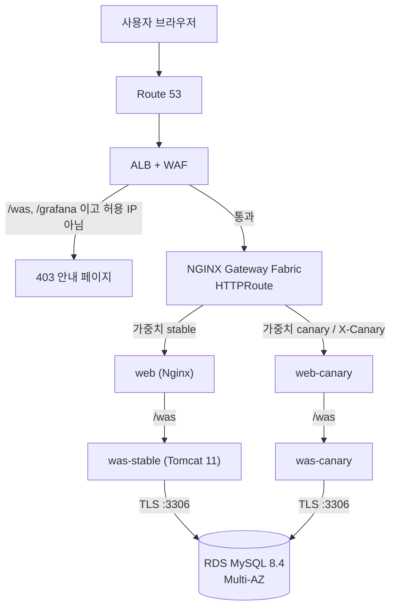

# EKS PetClinic 3-Tier — Amazon EKS 기반 컨테이너 3Tier 서비스 운영

| 구분 | 내용 |
|---|---|
| 프로젝트 유형 | 개인 프로젝트 (1인 설계·구현·운영) |
| 주제 | 쿠버네티스 관리형 서비스(Amazon EKS)로 3Tier 웹 서비스 운영 |
| 대상 애플리케이션 | Spring Framework PetClinic (WAR, Spring 7 / Java 21) |
| 작업 기간 | 2026-10-22 ~ 2026-10-27 |
| 리전 | AWS 서울 `ap-northeast-2` (AZ `2a` · `2c`) |
| 저장소 원칙 | 모든 인프라·배포를 스크립트와 매니페스트로 재현, Public 저장소이므로 시크릿은 코드에 두지 않음 |

> 계정 ID, ARN, 엔드포인트, 비밀번호 같은 실값은 이 문서와 저장소에 넣지 않았습니다.

---

## 1. 과제 정의

**목표**: 전통적인 WAR 기반 Spring 애플리케이션을 컨테이너로 만들어 EKS에 올리고, 실제 운영에 필요한 요소(고가용성, 자동 확장, 보안, 관측성, 무중단 배포, 백업, 비용 관리)를 코드로 재현할 수 있게 갖춘다.

| 계층 | 구성 |
|---|---|
| Presentation (WEB) | Nginx 1.27 — 공개 메인 페이지·정적 리소스 직접 응답, `/was/` 만 WAS로 프록시 |
| Application (WAS) | Tomcat 11 + Spring Framework 7 PetClinic (직원용 앱, `/was` 컨텍스트) |
| Data (DB) | Amazon RDS for MySQL 8.4 LTS, Multi-AZ, TLS 강제 |

**범위에서 뺀 것**: Spring Boot 전환, 멀티 리전, DB 스키마 변경, CodePipeline 자동 배포(빌드는 명령으로 실행)

### 목표별 결과 요약

| 목표 | 구현 | 검증 결과 |
|---|---|---|
| 고가용성 | 2개 AZ, AZ별 NAT, RDS Multi-AZ, Pod AZ 분산 | 롤링 배포·부하 테스트 중 AZ 균형 유지 (최대 8개일 때 2a 4 · 2c 4) |
| 자동 확장 | was KEDA(요청률), web HPA(CPU), Karpenter 노드 | 450 req/s에서 was 2 → 8개, 노드 2 → 5대, 부하 후 2로 축소 |
| 보안 | WAF, `/was`·`/grafana` IP 허용 목록, IRSA, NetworkPolicy, ESO | 허용 IP 밖의 `/was`·`/grafana` 접근은 403, 경로 우회 시도도 403 |
| 관측성 | Prometheus·Grafana, OpenTelemetry·Tempo, Slack 알림 | 404 10건에 5xx 오경보 없음 |
| 무중단 배포 | 카나리 라우팅, graceful shutdown | 롤링 재시작 중 요청 실패 923건 중 0건 (수정 전 707건 중 2건) |
| 백업 | `db-backup` CronJob, 매일 03:00 KST S3 적재 | 백업 파일 적재 확인 |
| 비용 관리 | 일일 중지·기동 스크립트, NAT 끄기 | 아침 기동 12분 13초, 오류 없음 |

---

## 2. 아키텍처


> 원본: [`docs/architecture-overview.drawio`](./docs/architecture-overview.drawio) · [`docs/architecture.drawio`](./docs/architecture.drawio) · 상세 명세 [`docs/architecture.md`](./docs/architecture.md)

### 요청 흐름

| 단계 | 구간 | 내용 |
|---|---|---|
| ① | 브라우저 → Route 53 | A(Alias) 레코드가 ALB를 가리킴 |
| ② | → AWS WAF → ALB `:443` | 관리형 규칙 3종(Common·SQLi·KnownBadInputs), `/was`·`/grafana` 는 허용 IP만, ACM으로 TLS 종단 |
| ③ | ALB → NGF Gateway | AWS Load Balancer Controller가 만든 ALB가 `target-type: ip` 로 Gateway Pod에 직접 전달 |
| ④ | Gateway → `web` / `web-canary` | Gateway API `HTTPRoute` 가중치 분할(평소 90:10), `X-Canary: always` 는 항상 canary |
| ⑤ | `web` → `was` `:8080` | 공개 페이지는 Nginx가 바로 응답(WAS·DB가 멈춰도 열림), `/was/` 만 Tomcat으로 |
| ⑥ | `was` → RDS `:3306` | TLS 필수, 앱 전용 최소 권한 DB 계정 |



---

## 3. 기술 스택

| 분류 | 구성 요소 | 버전 / 이미지 |
|---|---|---|
| **Application** | Spring Framework PetClinic | `7.0.3` (Spring `7.0.9`, Hibernate `7.4.11.Final`, Java 21) |
| **Web / WAS** | Nginx / Apache Tomcat 11 | `nginx:1.27.2-alpine`, `tomcat:11.0.2-jre21-temurin-noble`, `jmx_prometheus_javaagent:1.0.1` |
| **Kubernetes** | Amazon EKS / Worker AMI | EKS **`1.36`**, AL2023 |
| **Gateway / Ingress** | Gateway API / NGF / LBC | Gateway API CRDs **`v1.6.3`**, `nginx-gateway-fabric` **`2.8.0`**, `aws-load-balancer-controller` **`3.6.1`** |
| **Autoscaling** | Karpenter / KEDA / Metrics Server | Karpenter **`1.15.0`**, KEDA **`2.21.0`**, Metrics Server **`3.14.0`** |
| **Secrets / Storage** | ESO / EBS CSI Driver | `external-secrets` **`2.13.0`**, `aws-ebs-csi-driver` |
| **Observability** | Prometheus Stack / Fluent Bit | `kube-prometheus-stack` **`92.11.0`**, `aws-for-fluent-bit` **`0.2.0`** |
| **Tracing** | OTel Operator / Collector / Tempo | `opentelemetry-operator` **`0.105.0`**, `opentelemetry-collector` **`0.116.0`**, `autoinstrumentation-java:2.12.0`, `grafana/tempo:3.1.1` |
| **Database / Backup** | RDS for MySQL / S3 | MySQL **`8.4.11`** LTS (`db.t3.medium` Multi-AZ), `mysql:8.4.11` |
| **Build** | CodeBuild / ECR | `BUILD_GENERAL1_MEDIUM`, ECR `IMMUTABLE` 태그 + KMS 암호화 |

---

## 4. 주요 구현 내용

### 4.1 네트워크 (VPC)
- `provision-aws-resources.sh vpc` 한 번으로 VPC `10.0.0.0/16`, 서브넷 6개(퍼블릭·앱·DB × 2 AZ), IGW, 라우트 테이블 4개, AZ별 NAT 2개를 멱등하게 생성합니다.
- 앱 서브넷은 VPC CNI의 Pod당 IP 소비를 고려해 `/20` 으로 크게 잡았고, DB 서브넷에 인터넷 경로가 생기면 스크립트가 실패하고 멈춥니다(Fail-Closed).

### 4.2 데이터베이스 (RDS MySQL 8.4)
- Multi-AZ, gp3 암호화, 퍼블릭 접근 비활성화, `require_secure_transport=ON`, 자동 백업 7일, 삭제 방지.
- DB 계정을 역할별로 3분리(admin: `db-init` Job / app: `was` CRUD만 / backup: 덤프 읽기 권한만)하고, 비밀번호는 무작위 생성 후 Secrets Manager에 바로 저장합니다.
- 처음 설계한 8.0.39는 서울 리전에서 생성할 수 없었고 8.0은 표준 지원 종료로 확장 지원 요금이 붙어 **8.4 LTS**로 변경했습니다.

### 4.3 이미지 빌드
- 작업 서버(LXC)에서 컨테이너 빌드가 불가해 **AWS CodeBuild** 파이프라인을 만들었습니다 (`scripts/build-and-push.sh`, `buildspec.yml`).
- 멀티스테이지 빌드로 빌드 도구를 실행 이미지에서 제외, `latest` 금지·ECR `IMMUTABLE` 태그로 실행 중인 코드를 항상 추적할 수 있게 했습니다.

### 4.4 EKS 클러스터와 3티어 노드 분리
- `eksctl` + `infra/eksctl/cluster.yaml`, OIDC + **IRSA**(컨트롤러별 전용 IAM 역할, 정적 키 없음).
- EKS 1.36을 고른 이유: `PodTopologySpread` 의 `matchLabelKeys`, 선언형 `preStop.sleep` 이 GA.

| 노드 | 관리 | 워크로드 |
|---|---|---|
| `np-app` / `np-app-spot` | Karpenter NodePool (On-Demand 우선, 초과분 Spot) | NGF, web, was |
| `ng-critical` | EKS 관리형 노드 그룹 (Taint) | CoreDNS, LBC, Karpenter, KEDA, ESO, DB Job |
| `ng-platform` | EKS 관리형 노드 그룹 (Taint) | Prometheus, Grafana, Alertmanager, OTel, Tempo |

### 4.5 카나리 배포
- `web`/`was-stable` 과 `web-canary`/`was-canary` 버전을 분리합니다.
- 배포 시 `HTTPRoute` 를 **100:0** 으로 고정한 뒤 카나리를 롤아웃하고, `X-Canary: always` 헤더로 동적 DB 경로를 검증한 후에만 비율(기본 90:10)을 엽니다. 확대·롤백은 `scripts/set-canary-weight.sh` 로 재배포 없이 합니다.

### 4.6 오토스케일링
- **web**: CPU 60% 기준 HPA. **was**: Prometheus 요청률(50 req/s/Pod) 기준 KEDA `ScaledObject` (fallback 포함).
- Pod당 JDBC Pool 상한 `maxActive=10` 으로 최대 확장 시에도 RDS `max_connections` 고갈을 막습니다.

### 4.7 보안
- WAF 관리형 규칙 3종 + `/was`·`/grafana` IP 허용 목록, ALB HTTPS 강제.
- 모든 컨테이너 비루트(UID 10001), `readOnlyRootFilesystem`, `capabilities.drop: ALL`, `seccompProfile: RuntimeDefault`.
- `petclinic` 네임스페이스 `default-deny-all` NetworkPolicy, IMDSv2 강제·Pod IMDS 차단.
- 시크릿은 Secrets Manager → External Secrets Operator 동기화, 무중단 회전 스크립트 제공.

### 4.8 관측성
- Prometheus·Grafana·Alertmanager(Slack 알림), Fluent Bit → CloudWatch Logs.
- OpenTelemetry Operator가 이미지 재빌드 없이 Java agent를 주입하고 `service.version=stable|canary` 로 카나리를 구분합니다. 트레이스는 10% 샘플링, RED 메트릭은 100% 집계, exemplar로 Grafana 패널 → Tempo 트레이스로 이동합니다.

### 4.9 백업과 비용 관리
- `db-backup` CronJob이 매일 03:00 KST `mysqldump` 결과를 S3(SSE-KMS, 버전 관리)에 적재합니다.
- `daily-stop.sh` / `daily-start.sh` 로 업무 외 시간에 앱 노드·RDS·노드 그룹을 내리고, `--stop-nat` 으로 NAT Gateway까지 삭제해 비용을 줄입니다.

---

## 5. 운영 검증 결과

| 항목 | 내용 | 결과 |
|---|---|---|
| 카나리 실연 (v1.0.2) | 90:10 관측 10분 → 롤백 0% → 0/50/100% → 승격 | 1,996건 중 실패 0, 5xx 0, 롤백 반영 3초 |
| 롤링 배포 AZ 분산 | `matchLabelKeys: [pod-template-hash]` 적용 | 수정 전 한 AZ 몰림 → 수정 후 2a/2c 유지 |
| 무중단 롤링 재시작 | `preStop.sleep 15s` 로 EndpointSlice 전파 지연 흡수 | 실패 707건 중 2건 → **923건 중 0건** |
| Grafana 경로 보안 | 비허용 IP 접근 + 인코딩·대소문자 우회 시도 | 모두 403, 앱 영향 없음 |
| 5xx 알림 정확도 | 404 10건 발생 후 7분 관찰 | 새 규칙 inactive (예전 규칙이면 critical 발송) |
| 공개 페이지 / 직원 앱 분리 (v1.0.4) | WAF 규칙 → 카나리 검증 → 승격 | `/` 공개, `/was/`·`/grafana/` 비허용 IP 403 |
| 부하 테스트 (k6) | 50 → 150 → 300 → 450 req/s 단계 부하 | 276,139건, 실패 0.0018%, 5xx 0, p95 48ms, RDS CPU 최고 39.5% |

---

## 6. 트러블슈팅 (주요 사례)

| 증상 | 원인 | 해결 |
|---|---|---|
| 작업 서버에서 이미지 빌드 불가 | LXC 컨테이너의 rootless podman 제약 | AWS CodeBuild 빌드 파이프라인 도입 |
| `eksctl create cluster` exit 1 | 기본 애드온 `metrics-server` 가 taint 노드에서 Pending | 애드온 삭제 후 Helm으로 별도 설치 |
| 재배포 후 `x509: unknown authority` | `helm upgrade` 가 웹훅 인증서를 재발급 | `keepTLSSecret=true` |
| Slack 알림 전부 실패 (`400 no_text`) | Incoming Webhook은 일반 webhook JSON을 받지 않음 | `slack_configs` + `api_url_file` |
| 롤아웃 후 Pod가 한 AZ에 몰림 | 분산 계산에 구버전 ReplicaSet Pod 포함 | `matchLabelKeys: [pod-template-hash]` |
| 재시작 중 502/504 | EndpointSlice 전파 지연 | `preStop.sleep 15s`, grace 35/45초 |
| WAF `/grafana` 규칙 미매칭 | CLI v2가 `SearchString` 을 base64로 해석 | `--cli-binary-format raw-in-base64-out` |
| 404 몇 건에 5xx 알림 pending | Tomcat `errorCount` 가 4xx도 집계 | OTel RED 메트릭 `status_code=~"5.."` 로 교체 + promtool 테스트 |
| 새 WAS가 Ready 안 됨 | emptyDir가 이미지의 `rewrite.config` 를 가림 | 시작 스크립트에서 복사 |
| 리다이렉트가 `http://` 로 감 | 프록시 뒤 Tomcat이 scheme을 http로 인식 | `X-Forwarded-Proto` + `RemoteIpValve` |

---

## 7. 회고 및 개선 방향

**잘된 점**
- 모든 인프라·배포를 멱등 스크립트로 만들어 매일 중지·기동하면서도 같은 환경을 재현할 수 있었습니다.
- 카나리 100:0 격리 → 헤더 검증 → 개방 절차 덕분에 잘못된 태그 배포(v1.0.3) 두 번이 사용자 영향 없이 검사에서 멈췄습니다.
- 수치로 검증(요청 실패 건수, AZ 분포, 알림 상태)하고 나서야 기능을 완료로 봤습니다.

**후속 과제**
- `cluster.yaml` 에서 eksctl 기본 애드온 끄기
- `daily-stop` 시 PDB(`allowed=0`)로 인한 노드 종료 대기 대응
- 배포 스크립트에서 명령줄 이미지 태그가 `.env` 보다 우선하도록 처리
- 비밀이 아닌 `.env` 값의 안전한 보관 위치 마련
- CodePipeline 기반 자동 배포

**협업 방식**: 설계·보안 점검(Antigravity), 구현(Claude), 코드 리뷰(Codex)로 AI 에이전트 역할을 나누고 기능마다 `design.md → 구현 → review.md/security.md` 순서로 진행했습니다 ([`ORCA_WORKFLOW.md`](./ORCA_WORKFLOW.md)).

---

## 8. 실행 방법

설치·배포·운영 절차는 [`docs/getting-started.md`](./docs/getting-started.md) 에 있습니다.

```bash
cp .env.example .env                                   # 값 입력
./infra/aws/provision-aws-resources.sh vpc             # 이후 pre-cluster → cluster → post-cluster → grafana-waf
IMAGE_TAG=v1.0.0 ./scripts/build-and-push.sh           # CodeBuild로 이미지 빌드·ECR 푸시
STABLE_IMAGE_TAG=v1.0.0 CANARY_IMAGE_TAG=v1.0.0 ./scripts/deploy-all.sh
```

---

## 9. 디렉터리 구조 및 문서

```text
.
├── app/            # spring-framework-petclinic 소스 (WAR)
├── docker/         # web (Nginx) / was (Tomcat 11 + JMX Exporter) Dockerfile
├── infra/          # AWS 프로비저닝 스크립트, IAM 최소 권한 정책, eksctl, Karpenter
├── k8s/            # Kubernetes 매니페스트 (base, secrets, jobs, web, was, gateway, monitoring, logging, tracing)
├── scripts/        # 빌드·배포·카나리·시크릿 회전·중지/기동·정적 검증
├── tests/          # PrometheusRule 단위 테스트 (promtool)
└── docs/
    ├── architecture.md        # 아키텍처 상세 명세
    ├── getting-started.md     # 실행 가이드
    ├── features/<기능명>/      # 기능별 design.md · review.md · security.md
    └── daily/                 # 일일 작업 기록
```

- 아키텍처 명세: [`docs/architecture.md`](./docs/architecture.md)
- 초기 구축 설계·리뷰·보안 점검: [`docs/design.md`](./docs/design.md) · [`docs/review.md`](./docs/review.md) · [`docs/security.md`](./docs/security.md)
- 기능별 문서: [`docs/features/`](./docs/features/)
- 일일 작업 기록: [`docs/daily/`](./docs/daily/)
